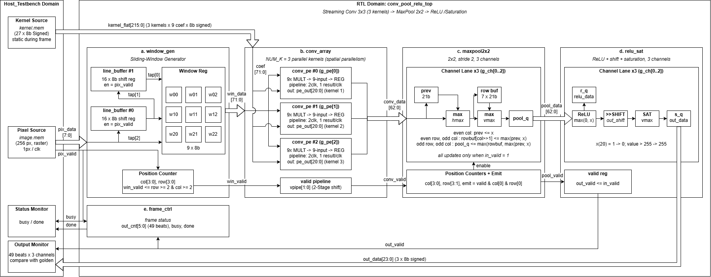
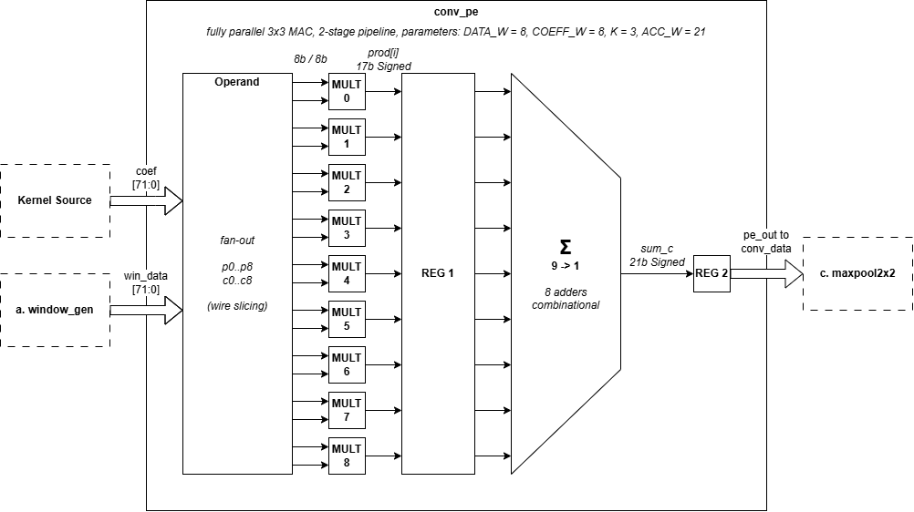
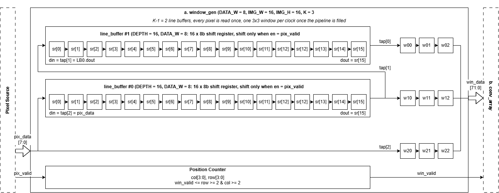
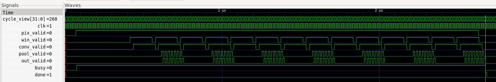

# Parallel Convolution (3×3) + Maxpooling + ReLU Engine

Synthesizable Verilog RTL implementing a streaming **3×3 convolution (3 kernels) → 2×2 maxpooling → ReLU** pipeline, with two levels of hardware parallelism: **3 parallel processing elements (PE)**, one per kernel, each containing **9 parallel multipliers**, one per 3×3 window element. All 27 multiplications for a single window position complete in one clock cycle, and all three output channels are produced simultaneously.

## 1. Specification

| Item | Value |
|---|---|
| Input image | 16×16, 1 channel (grayscale), 8-bit unsigned |
| Kernels | 3, each 3×3, 8-bit signed |
| Convolution | stride 1, valid (no padding) → 14×14 per kernel |
| Channels after convolution | 3 channels, 14×14×3 |
| Maxpooling | 2×2, stride 2 → 7×7×3 |
| ReLU | `f(x) = x if x ≥ 0 else 0`, per element |
| Final output | 7×7×3, 8-bit unsigned (saturated) |

The design is fully parameterizable (image size, kernel size, number of kernels, data widths — see `rtl/conv_pool_relu_top.v`); the defaults above match the task specification. One structural constraint: the convolution output size `(IMG − K + 1)` must be even so that 2×2/stride-2 maxpooling divides the image evenly.

## 2. Architecture

The top module `conv_pool_relu_top` chains five stages as a streaming pipeline (1 input pixel/clock, no backpressure — only `valid`/`data` handshaking):

```
pix_data/pix_valid → window_gen → conv_array → maxpool2x2 → relu_sat → out_data/out_valid
                                        │
                                  frame_ctrl (busy / done)
```

**Two-level parallelism:**
- **Inter-kernel (spatial, 3 PE):** three `conv_pe` instances share the same 3×3 window and run concurrently → 3 output channels per clock.
- **Intra-PE (9 multipliers):** each `conv_pe` multiplies all 9 window elements in parallel and reduces them with a combinational adder tree → 1 convolution result per clock (not 9).
- **Inter-stage (pipeline):** window generation, convolution, pooling, and ReLU overlap as a 5-stage pipeline.

**Top-level block diagram:**



**`conv_pe` — single-kernel PE (9 parallel multipliers + adder tree, 2-stage pipeline):**



**`window_gen` — sliding-window generator (2 line buffers + 3×3 window register):**



### Pipeline latency

| Stage | Latency (clock) |
|---|---|
| `window_gen` | 1 |
| `conv_array` | 2 |
| `maxpool2x2` | 1 |
| `relu_sat` | 1 |
| **Total** | **5** |

A full frame completes in **261 clocks** (256 clocks to stream the 256 input pixels + 5 clocks of pipeline depth), measured from the first pixel to the last valid output beat.

## 3. Repository Structure

```
Parallel_Convolution_Pool_ReLU_Engine
├── rtl/                          Synthesizable RTL
│   ├── conv_pool_relu_top.v        Top-level module
│   ├── window_gen.v                Raster stream → 3×3 sliding window
│   ├── line_buffer.v               Single image-row shift register (used by window_gen)
│   ├── conv_array.v                3× conv_pe instances (generate) + valid pipeline
│   ├── conv_pe.v                   Single-kernel 3×3 MAC: 9 multipliers + adder tree, 2-stage pipeline
│   ├── maxpool2x2.v                Streaming 2×2/stride-2 max pooling, 3 channels
│   ├── relu_sat.v                  ReLU + optional right-shift + saturate to 8-bit
│   └── frame_ctrl.v                Frame busy/done status reporting
├── tb/
│   ├── tb_conv_pool_relu_top.v     Self-checking testbench (see §4)
│   └── vectors/
│       ├── image.mem                 16×16 8-bit unsigned test image (hex, one value/line)
│       └── kernel.mem                3× 3×3 8-bit signed kernels (hex, one value/line)
├── scripts/
│   └── golden_model.py             Pure-Python reference model (no dependencies), cross-checked
│                                    against the RTL/testbench output for every stage
├── docs/
│   ├── architecture/               Block diagrams referenced in §2
│   └── result/                     Waveform screenshots from simulation (see §5)
└── README.md
```

## 4. Module Overview

| Module | Instances | Function |
|---|---|---|
| `conv_pool_relu_top` | 1 | Top-level, wires all stages together |
| `window_gen` | 1 | Converts raster pixel stream into 3×3 windows |
| `line_buffer` | `K−1` = 2 | 16×8-bit shift register, one per delayed image row |
| `conv_array` | 1 | Instantiates `NUM_K` parallel `conv_pe`s + 2-stage valid pipeline |
| `conv_pe` | `NUM_K` = 3 | One kernel's 3×3 MAC: 9 multipliers → 8-adder tree → accumulator |
| `maxpool2x2` | 1 | Streaming 2×2/stride-2 max pooling, 3 channels, no full feature-map buffer |
| `relu_sat` | 1 | ReLU, optional shift, saturation to `OUT_W`-bit unsigned |
| `frame_ctrl` | 1 | Reports `busy`/`done` per frame (does not gate the datapath) |

All stages use the same convention: a `valid`/`data` pair, clock-synchronous, no `ready`/backpressure signal — stalls can only originate at the input (`pix_valid` low). Every stage computes its own output-valid; data registers only update when their input-valid is high (except `conv_pe`, which runs free-running and is only meaningful when marked valid by `conv_array`'s pipeline), so the pipeline tolerates arbitrary gaps on `pix_valid` without corrupting data.

### Accumulator sizing

`conv_pe` products are 17-bit signed (`DATA_W + COEF_W + 1`); the final accumulator is `ACC_W = 21` bits signed (`DATA_W + COEF_W + 1 + ⌈log₂(K·K)⌉`). Worst case: `9 × 255 × 128 = 293,760`, which fits comfortably within the ±2²⁰ range of 21-bit signed — verified directly in simulation (Test 2, below).

## 5. Verification

Simulation is run with **Icarus Verilog** against the self-checking testbench `tb/tb_conv_pool_relu_top.v`, which compares every pipeline stage element-by-element against a behavioural reference (mirrored by `scripts/golden_model.py`): `conv_array` output (588 values = 3 channels × 14×14), `maxpool2x2`, `relu_sat` (pre-saturation), and the final `out_data` (147 values = 3 channels × 7×7 each). A test passes only if all 1,029 compared values match exactly.

Three scenarios, 10 sub-tests total, all **PASS**:

| Test | Description |
|---|---|
| **Test 1** | Main assignment vector, back-to-back pixels (`pix_valid` always 1) |
| **Test 2** | Corner case: all pixels = 255, extreme kernel coefficients (127 / −128), to stress the 21-bit accumulator |
| **Test 3** | 8 random frames — 3 with no stall, 5 with 35% per-clock random `pix_valid` deassertion, to test pipeline robustness against input gaps |

Key measured results:
- **Latency:** 261 clocks/frame (no stall), matching the analytical prediction (256 + 5) exactly.
- **Speedup vs. a hypothetical sequential 1-MAC design:** ≈ 20.3× (5,292 clocks sequential vs. 261 clocks parallel for convolution + pooling + ReLU). The theoretical compute-only upper bound is 27× (= 3 PE × 9 multipliers); actual latency is I/O-bound by the 1-pixel/clock input interface rather than compute-bound.
- **Accumulator range:** extremes of +291,465 / −293,760 observed in Test 2, within the 21-bit signed range — no overflow.
- **Stall robustness:** one 35%-stall frame measured at 390 clocks (≈1.49× a clean frame), close to the theoretical expectation of ≈399 clocks (1/(1−0.35) scaling), with data remaining correct throughout.

Waveform evidence for the above (captured with a `cycle_view` counter for easy clock-accurate reading) is in [`docs/result/`](docs/result/), covering pipeline fill, window assembly, parallel 3-channel convolution, the maxpool/ReLU/saturation datapath, end-of-frame timing, and the stall-test behaviour.

**Overview of one full frame** (`cycle_view` ≈ 0–268): `pool_valid`/`out_valid` appear as 7 periodic pulse bursts (49 outputs in 7 groups of 7), and `busy`/`done` mark the frame boundary:



## 6. Running the Simulation

```bash
make sim           # Test 1–3 with OUT_SHIFT = 0 (default, matches tb/vectors/*.mem)
make sim_shift8    # same, with OUT_SHIFT = 8 (avoids heavy saturation on channels 1/3)
make golden        # run scripts/golden_model.py and print the Python reference output
```

Or directly with Icarus Verilog:

```bash
iverilog -g2012 -o sim.out rtl/*.v tb/tb_conv_pool_relu_top.v
vvp sim.out
```

## 7. Known Limitations

- Critical path (8 chained 21-bit adders inside `conv_pe`, between the multiply and accumulate registers) has not been measured — the design has not been synthesized; `Fmax` is unknown.
- Kernel coefficients (`kernel_flat`) are static for the duration of a frame; changing them mid-frame corrupts the result.
- Throughput is bounded by the 1-pixel/clock input interface (256-clock floor per frame); a wider input would approach the 27× compute-bound speedup.
- The next frame should start only after `done`; back-to-back frames with no gap are untested.
- `OUT_SHIFT` must be tuned per workload to avoid saturating most of the 8-bit output range (see design notes in the accompanying report).


## Author
Andhika Narawangsa Susilo - https://github.com/andhikanarawangsa
